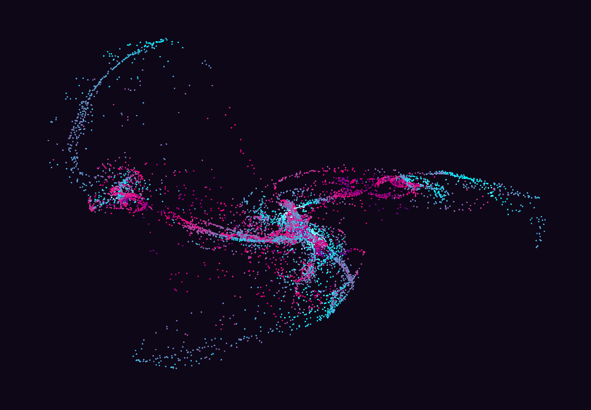
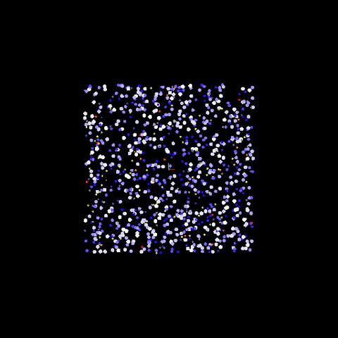
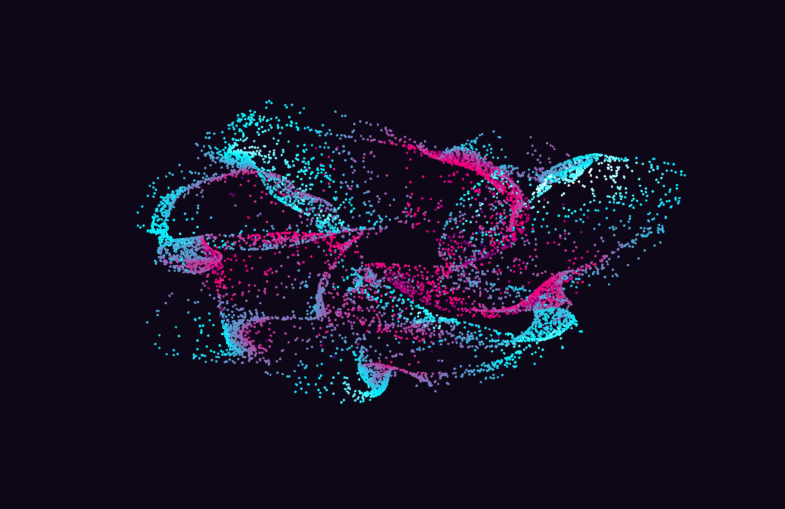
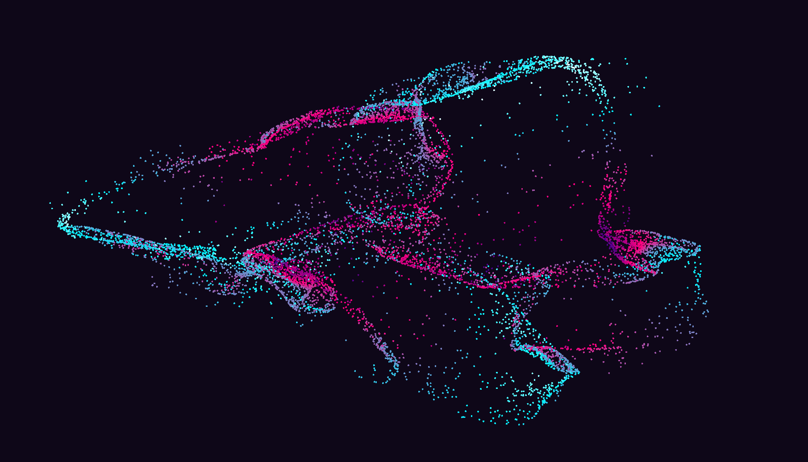

# N-Body Gravitational Simulations

N-Body Gravitational Simulations, currently written in Python, with intention to be re-written in C++ for real-time large body-quantity simulations. The project itself is to explore different N-Body problem implementations as well as to create fancy animations.

It implements direct summation through Velocity Verlet algorithm with O(n^2) time complexity and a Barnes-Hut algorithm with O(n*log(n)) time complexity.

## Direct Sum 2D Simulation of 1000 Bodies

## Barnes Hut Flat Structure of Arrays Implementation

## To run this project

1) Have Python of at least 3.15.0 version installed
2) Install Requirements
3) main.py is the entry point, currently without command line arguments support

***What you can do at the moment:***

- Play around with exposed DirectSum and FlatBHut2DSim and configure them as you wish.
- By default they are set to uniform body spawn within circle or sphere of customisable R - radius depending on 2D or 3D mode
- Please note that 1000+ body simulations will be rendered most likely at sub 30-FPS, even on such CPU as 7950x3d, so don't expect a lot.
