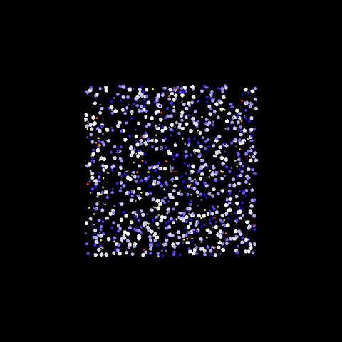

# N-Body Simulation

N-Body Simulation Project, currently written in Python, with intention to be re-written in C++ for real-time large body-quantity simulations. The project itself is to explore different N-Body problem implementations as well as to create fancy animations.

It implements direct summation through Velocity Verlet algorithm with O(n^2) time complexity and a Barnes-Hut algorithm with O(n*log(n)) time complexity.

## (Direct Sum) Velocity Verlet 2D Simulation of 1000 Bodies

